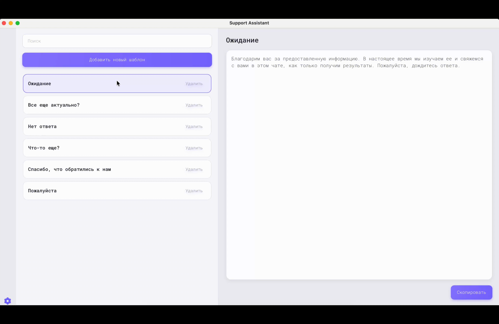
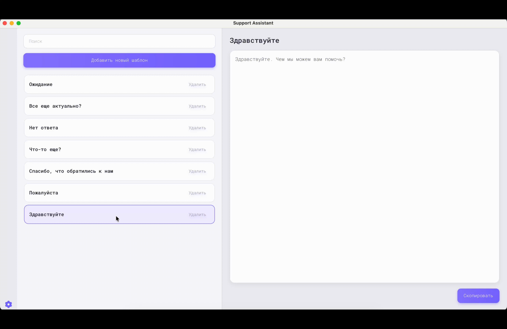

# Support Assistant 

Desktop приложение разработанное на JavaFX, предназначенное для специалистов службы поддержки. Приложение позволяет быстро управлять шаблонами ответов, выполнять мгновенный поиск и вставлять готовые сообщения





___

## Возможности

- Создание и удаление шаблонов
- Быстрый поиск по названию
- Хранение данных в SQLite
- Глобальная горячая клавиша для открытия приложения
- Копирование шаблона в буфер обмена
- Поддержка нескольких языков интерфейса
___
### [Скачать последнюю версию](https://github.com/RasimTahirov/Support-Assistant/releases)
___

## Стек технологий
- Java 21
- JavaFX
- Maven
- SQLite
- JNativeHook
- Logback
- Jackson
- Ikonli

## Запуск и сборка
```bash
  git clone https://github.com/RasimTahirov/Support-Assistant.git
```

```bash
  mvn javafx:run
```

```bash
  mvn clean package
```

Для создания установщика используется `jpackage`